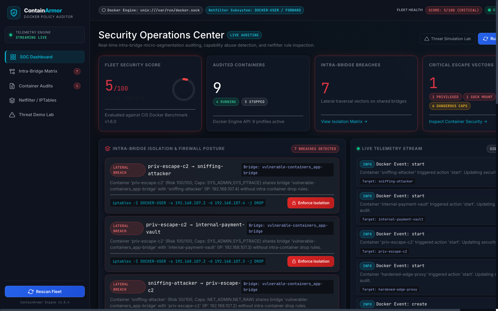
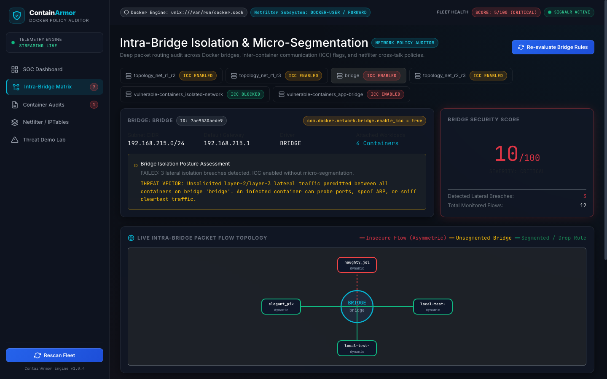
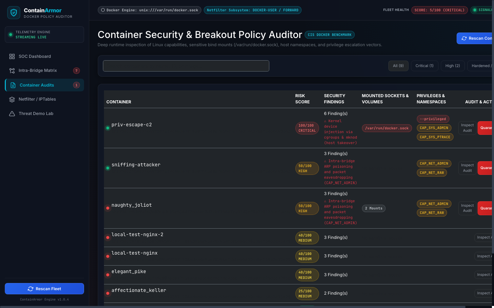
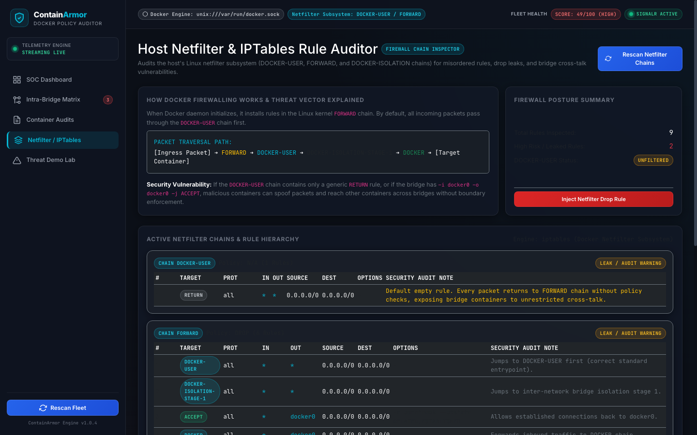
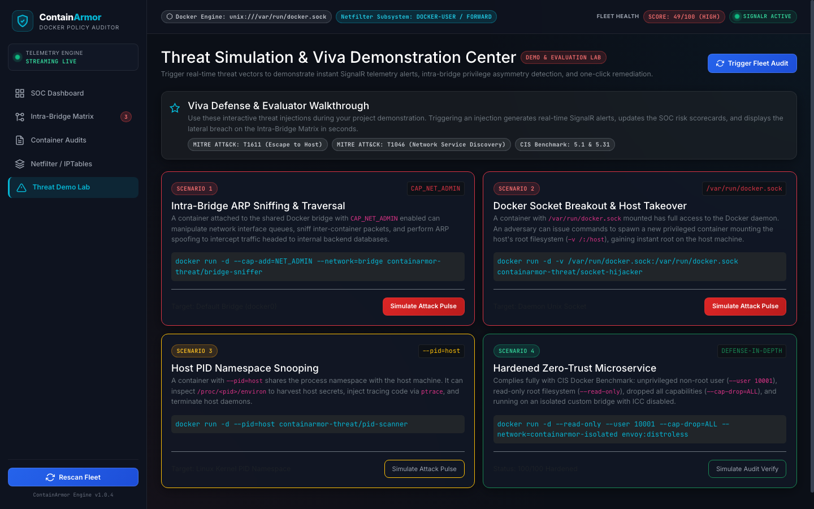
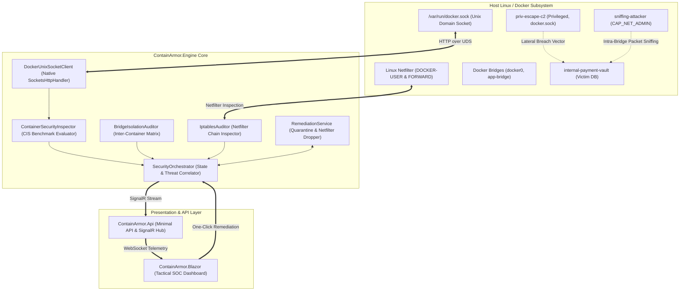

# ContainArmor (NetGuard-Docker)
> **A Real-Time Docker Container Security & Intra-Bridge Network Isolation Policy Auditor**

[](https://github.com/Namanbhatt-01/ContainArmor/actions)
[](#test-suite-and-quality-assurance)
[](https://dotnet.microsoft.com/)
[](https://www.docker.com/)
[](https://learn.microsoft.com/aspnet/core/signalr/)
[](#cis-docker-benchmark-rule-matrix)
[](https://attack.mitre.org/matrices/enterprise/cloud/container/)
[](LICENSE)

---

## Executive Summary

When Docker containers execute on shared bridge networks (`docker0` or user-defined bridges), **micro-segmentation failures, capability misconfigurations (`CAP_NET_ADMIN`, `privileged`), leaked iptables rules, and insecure mounted sockets (`/var/run/docker.sock`)** frequently go unnoticed.

By default, Docker bridge networks operate with Inter-Container Communication enabled (`com.docker.network.bridge.enable_icc = true`), permitting any container to transmit layer-2/layer-3 traffic to any peer on the same bridge. An attacker who compromises a single edge microservice can exploit this **privilege asymmetry** to sniff plaintext traffic, poison ARP tables, and reach unauthenticated internal payment vaults or databases.

**ContainArmor** is a real-time security operations platform that audits runtime isolation breaches, inspects host netfilter/iptables rules, and visualizes live security telemetry on a Blazor dark-mode tactical SOC dashboard with automated one-click remediation.

---

## Technical Specifications

| Parameter | Specification | Details |
|---|---|---|
| Runtime Engine | .NET 9.0 / C# 13 | High-performance asynchronous pipeline with zero external Docker API dependencies |
| Transport Mechanism | Native Unix Domain Sockets | Direct HTTP/1.1 communication over `/var/run/docker.sock` via `SocketsHttpHandler` |
| Real-Time Streaming | ASP.NET Core SignalR | Sub-second push notifications over WebSockets with automatic fallback |
| Frontend Dashboard | Blazor Server | Cyber SOC dark theme, reactive state lifecycle, and interactive SVG topology |
| Compliance Standard | CIS Docker Benchmark v1.6.0 | Evaluates rules 5.1, 5.2, 5.3, 5.4, 5.5, 5.6, 5.7, 5.12, and 5.31 |
| Firewall Hook | Linux Netfilter (iptables) | Audits `DOCKER-USER`, `FORWARD`, and `DOCKER-ISOLATION` chains |
| Remediation Controls | Atomic Container Actions | Automated network disconnection, SIGSTOP pause, and netfilter drop injection |

---

## User Interface and Visual Verification

### 1. Security Operations Center (SOC) Dashboard
Live fleet security posture, circular health score ring, active intra-bridge breaches, and real-time SignalR event feed.



---

### 2. Intra-Bridge Isolation Matrix and Packet Flow Topology
Interactive SVG topology diagram visualizing bridge routers, pod endpoints, privilege asymmetry vectors, and 2D connectivity matrix.



---

### 3. Container Security and CIS Benchmark Auditor
Deep runtime inspection of Linux capabilities, socket bind mounts, host namespaces, and one-click container quarantine controls.



---

### 4. Host Netfilter and IPTables Rule Auditor
Inspection of the kernel's `DOCKER-USER` and `FORWARD` chains, detection of promiscuous bridge accepts, and targeted drop rule injection.



---

### 5. Threat Simulation Lab (Viva Evaluation Center)
Interactive evaluation lab to trigger real-world container breakout vectors, ARP sniffing pulses, and verify automated defense responses.



---

## System Architecture



---

## Threat Model and Attack Vectors

### 1. Intra-Bridge Lateral Traversal (The Default ICC Trap)
* **Vulnerability**: Docker's default bridge configuration enables ICC (`com.docker.network.bridge.enable_icc = true`).
* **Threat**: A compromised container with `CAP_NET_ADMIN` or `CAP_NET_RAW` can execute ARP spoofing (`arpspoof`) or eavesdrop (`tcpdump`) on neighboring workloads sharing `docker0` or user-defined bridges.
* **ContainArmor Detection**: Detects capability and risk asymmetry between peer containers on the same subnet, generates a directional 2D matrix, and synthesizes isolation rules:
  ```bash
  iptables -I DOCKER-USER -s 172.20.0.2 -d 172.20.0.3 -j DROP
  ```

### 2. The `DOCKER-USER` Netfilter Chain Gap
* **Vulnerability**: Docker routes incoming forwarded packets through `DOCKER-USER` before `FORWARD`. In default setups, `DOCKER-USER` contains only an unconditional `RETURN` target.
* **Threat**: Uninspected packets drop through to Docker's internal rule:
  ```bash
  -A FORWARD -i docker0 -o docker0 -j ACCEPT
  ```
  allowing unhindered cross-container communications.
* **ContainArmor Detection**: Flags missing drop rules, alerts on promiscuous accepts, and provides automated one-click drop rule injection.

### 3. Docker Socket Hijacking and Host Escape
* **Vulnerability**: Bind-mounting `/var/run/docker.sock` into application containers.
* **Threat**: Processes inside the container can command the host Docker API to deploy root-level containers mounting the host root filesystem (`docker run -v /:/host alpine chroot /host`).
* **ContainArmor Detection**: Evaluates container mounts against **CIS Benchmark 5.31**, marks the container as `CRITICAL` (score 100), and broadcasts real-time SignalR alerts.

---

## MITRE ATT&CK for Containers Matrix Mapping

| MITRE ATT&CK ID | Technique Name | Tactic | ContainArmor Audit Mechanism |
|---|---|---|---|
| **T1611** | Escape to Host | Privilege Escalation | Audits `--privileged` flag, sensitive mount points (`/proc`, `/sys`, `/etc`), and `/var/run/docker.sock`. |
| **T1610** | Deploy Container | Execution | Inspects Docker socket mounts and identifies unauthorized container launch primitives. |
| **T1046** | Network Service Discovery | Discovery | Flags unsegmented bridge networks allowing unrestricted port scanning across container boundaries. |
| **T1040** | Network Sniffing | Credential Access | Detects `CAP_NET_ADMIN` and `CAP_NET_RAW` capabilities on shared bridges without ICC restriction. |
| **T1053** | Scheduled Task / Job | Persistence | Identifies writable root filesystems (`--read-only` missing) where attackers persist execution payloads. |
| **T1055** | Process Injection | Privilege Escalation | Inspects `CAP_SYS_PTRACE` and flags shared process namespaces (`--pid=host`). |

---

## CIS Docker Benchmark Rule Matrix

| Rule ID | CIS Benchmark v1.6.0 Rule | Severity | Real-World Threat Impact | ContainArmor Mitigation |
|---|---|:---:|---|---|
| **CIS-5.1** | Do not run containers in privileged mode | `CRITICAL` | Defeats namespaces and cgroups; allows direct host device access | One-click Quarantine / Terminate |
| **CIS-5.31**| Do not mount Docker socket `/var/run/docker.sock` | `CRITICAL` | Direct host takeover via Docker daemon API | Threat Alert & Socket Mount Flag |
| **CIS-5.2** | Drop dangerous capabilities (`SYS_ADMIN`, `NET_ADMIN`, `SYS_PTRACE`) | `HIGH` | `SYS_ADMIN` enables cgroup escape; `NET_ADMIN` allows ARP sniffing | Isolate from Bridge Network |
| **CIS-5.5** | Do not share host network namespace (`--net=host`) | `HIGH` | Bypasses container network isolation and firewall | Isolate host interface binding |
| **CIS-5.6** | Do not share host process namespace (`--pid=host`) | `HIGH` | Can inspect `/proc/$PID/environ` and send kill signals to host daemons | Alert & Host PID Flag |
| **CIS-5.4** | Do not run container processes as root (UID 0) | `MEDIUM` | Exploits immediately gain root privileges upon container breakout | Enforce unprivileged user (`--user 10001:10001`) |
| **CIS-5.12**| Mount root filesystem as read-only (`--read-only`) | `MEDIUM` | Attackers persist tools and web shells on writable root | Enforce read-only baseline with tmpfs |
| **NET-ICC** | Disable default bridge ICC (`--icc=false`) | `HIGH` | Unsegmented cross-talk on shared layer-2 bridge | Inject `DOCKER-USER` Drop Rule |

---

## Quickstart Guide

### Option 1: Run with Docker Compose (Recommended)
```bash
# Clone the repository
git clone https://github.com/Namanbhatt-01/ContainArmor.git
cd ContainArmor

# Build and start ContainArmor with the host Docker socket mounted
docker compose up -d

# Open the dashboard in your browser
open http://localhost:5200
```

### Option 2: Local Development (.NET 9 SDK)
```bash
# Restore and build the solution
dotnet restore ContainArmor.sln
dotnet build ContainArmor.sln

# Launch the interactive Blazor SOC dashboard
dotnet run --project src/ContainArmor.Blazor --urls http://127.0.0.1:5200
```

---

## Live Threat Demonstration Fleet

ContainArmor includes an automated vulnerable container test lab under `tests/vulnerable-containers/` to simulate real-world attacks:

```bash
# Deploy the vulnerable test fleet
bash tests/vulnerable-containers/run-demo.sh
```

This deploys 4 targeted workloads:
1. `priv-escape-c2`: Privileged container mounting `/var/run/docker.sock` and `CAP_SYS_ADMIN` on `app-bridge`.
2. `sniffing-attacker`: Attacker container with `CAP_NET_ADMIN` and `CAP_NET_RAW` on `app-bridge`.
3. `internal-payment-vault`: Sensitive container on `app-bridge` (victim of lateral traversal).
4. `hardened-edge-proxy`: Hardened non-root microservice (`10001:10001`) with read-only rootfs on `isolated-network` (`ICC=false`).

### Demonstration Workflow:
1. Open [http://localhost:5200](http://localhost:5200) to observe the **5/100 (CRITICAL)** fleet score and instant detection of **7 Lateral Breaches**.
2. Navigate to **Intra-Bridge Matrix** to view the interactive packet flow SVG diagram and 2D connectivity grid.
3. Click **Enforce Isolation** to inject a netfilter drop rule into `DOCKER-USER`.
4. Navigate to **Container Audits** and click **Quarantine** on `sniffing-attacker` to disconnect it from active bridges in real time.
5. Tear down the demo fleet:
   ```bash
   docker compose -f tests/vulnerable-containers/docker-compose.vuln.yml down
   ```

---

## Test Suite and Quality Assurance

All unit tests are executed using **xUnit** and verify container security scoring, intra-bridge asymmetry detection, netfilter parsing, and automated remediation pipelines:

```bash
dotnet test ContainArmor.sln --logger "console;verbosity=detailed"
```

### Automated Test Coverage (35 Passed, 0 Failed):
* **`ContainerSecurityInspectorTests`** (15 tests): CIS 5.1 Privileged mode, CIS 5.31 Socket mounting, CIS 5.2 Dangerous capabilities, CIS 5.5-5.7 Host namespaces, CIS 5.4 Root user formats (`0`, `0:0`, `root`), CIS 5.3 Sensitive mounts (`/proc`, `/sys`, `/etc`), AppArmor / Seccomp opts, and null-safety.
* **`BridgeIsolationAuditorTests`** (5 tests): Intra-bridge privilege asymmetry, ICC enable/disable flags, multi-container matrix (3+ containers), non-bridge driver filtering (`host`, `null`, `overlay`), empty bridge handling, and interface fallback rules for stopped containers.
* **`IptablesAuditorTests`** (3 tests): `DOCKER-USER` chain gap detection, `FORWARD` promiscuous `-i docker0 -o docker0 -j ACCEPT` leak detection, and breach cross-referencing with targeted DROP rule generation.
* **`RemediationServiceTests`** (6 tests): Dynamic `DOCKER-USER` drop injection, container quarantine & bridge disconnect, pause/unpause/stop execution, null container ID tolerance, unknown action handling, and history tracking.
* **`SecurityOrchestratorTests`** (6 tests): Fleet audit correlation, remediation dispatching, event buffer capping (max 200), empty fleet baseline health score 100, and dynamic remediation injection into cached iptables.

---

## Repository Structure

```text
ContainArmor/
├── .github/
│   └── workflows/
│       └── ci.yml                     # GitHub Actions CI workflow (Build, Test, Docker)
├── assets/
│   └── screenshots/                   # High-resolution dashboard screenshots
│       ├── soc-dashboard.png
│       ├── network-topology.png
│       ├── container-audits.png
│       ├── firewall-audit.png
│       └── threat-simulation.png
├── src/
│   ├── ContainArmor.Engine/           # Core auditing and remediation engine
│   │   ├── Models/                    # Domain models, CIS Benchmark & Netfilter schemas
│   │   └── Services/                  # Docker UDS client, Inspector, BridgeAuditor, IptablesAuditor
│   ├── ContainArmor.Api/              # ASP.NET Core Minimal API & SignalR telemetry hub
│   └── ContainArmor.Blazor/           # Interactive Blazor Server tactical SOC dashboard
│       ├── Components/Pages/          # Dashboard, Topology, Audits, Firewall, ThreatLab
│       └── Services/                  # State management & SignalR streaming client
├── tests/
│   ├── ContainArmor.Tests/            # Comprehensive xUnit test suite (35 tests)
│   └── vulnerable-containers/         # Multi-container demo exploit fleet
├── .gitignore                         # Comprehensive .NET / Docker gitignore
├── CONTRIBUTING.md                    # Development and contribution guide
├── Dockerfile                         # Multi-stage container build with netfilter tools
├── docker-compose.yml                 # Production compose configuration
├── LICENSE                            # Apache 2.0 Open Source License
├── README.md                          # Platform documentation & threat guide
└── SECURITY.md                        # Vulnerability disclosure policy
```

---

## License

This project is licensed under the [Apache License 2.0](LICENSE).
